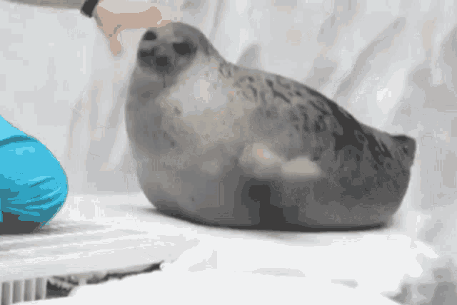

  <picture>
    <source media="(prefers-color-scheme: dark)" srcset="readme-assets/greeting-dark.svg">
    
  </picture>
  

  <samp>data science &amp; LLM &amp; CV</samp>

  

<table>
<tr>
<td width="50%" valign="top">

### 💼 at work

data scientist @ alice AI

i work with datasets, annotations, and the pipelines behind LLM evaluation.

- evaluation datasets and annotations.
- model comparisons and result analysis.
- SQL, pipelines, and dashboards.

</td>
<td width="50%" valign="top">

### 🎓 education

sophomore @ HSE university & central university

[HSE university](https://www.hse.ru/en/ba/eda) 
economics and data science 
applied mathematics and computer science + economics

[central university](https://cu.ru/bachelor) 
mathematics and computer science

</td>
</tr>
</table>

📚 i also teach competitive maths and ML to school students and teachers. proud of my IOAI medalists &lt;3

## 🛠 my toolkit

<picture>
  <source media="(max-width: 600px) and (prefers-color-scheme: dark)" srcset="readme-assets/toolkit-mobile-dark.svg">
  <source media="(max-width: 600px)" srcset="readme-assets/toolkit-mobile-light.svg">
  <source media="(prefers-color-scheme: dark)" srcset="readme-assets/toolkit-dark.svg">
  
</picture>

## 🦭 beyond the datasets

🏸 always up for badminton. 
🧠 curious about cognitive science and how the mind works. 
🤫 former competitive programmer.

 

📂 a few things i've worked on before

### data analysis

- [🔥 temporal factors and employee burnout — hh.ru](https://github.com/n11chanch/dano_2023)
- [🎰 investor behaviour in critical situations — tinkoff investments](https://github.com/n11chanch/dano_2024)
- [💳 factors influencing wages — RLMS-HSE](https://github.com/n11chanch/dano_hack)

### research

- [🧠 подходы для тестирования индивидуальных эмоциональных характеристик человека](https://neuro.hse.ru/emotional_condition/news/947779549.html) — research supported by HSE.
- [💻 методы дистанционного мониторинга психофизиологического состояния человека](http://sirius.imbp.ru/) — research supported by IMBP RAS.

 

  ✦ you can find me anywhere, just type in @niichanch ✦

